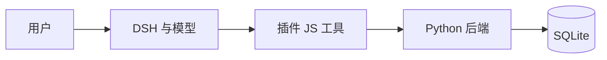

# Slidev 写作与展示指南

适用对象：第一次用 Markdown 做技术汇报的同学。语法按本项目安装的 Slidev **53.1.0** 核对；默认主题为 `default`，不同主题的布局和样式可能不同。本文是阅读用的指南，不要直接当作幻灯片入口运行。

## 1. 先分清：内容、样式、交互分别写在哪里

Slidev 不是一种全新的编程语言，而是把 Markdown、YAML、HTML/CSS 和 Vue 组合起来渲染成网页幻灯片。

| 写法 | 负责什么 | 常见例子 | 展示效果 |
| --- | --- | --- | --- |
| Markdown | 正文内容 | `# 标题`、列表、代码围栏 | 标题、段落、列表、代码 |
| YAML 页头 | 整套／单页配置 | `theme: default`、`layout: center` | 主题、布局、背景、字体 |
| HTML | 内容容器 | `<div>`、``、`<button>` | 分栏、图片、按钮 |
| CSS／UnoCSS | 外观 | `class="text-teal-300"` | 颜色、大小、间距、位置 |
| Vue／Slidev | 交互 | `v-click`、`@click`、`<Link>` | 逐步出现、翻页、页内跳转 |

不必先学完 Vue。先会分页、标题、图片和代码块，之后逐项加设计就够了。

### 本项目文件对应关系

```text
presentation/
├─ slides.md                    原来的 4 页样稿（端口 3030）
├─ style.css                    原样稿的统一样式
├─ public/candidates.html       原样稿使用的空看板
├─ package.json                 启动、构建命令和依赖
└─ guide/
   ├─ Slidev写作与展示指南.md    本文：查语法
   ├─ skeleton.md              6 页可运行骨架（端口 3031）
   ├─ style.css                骨架独立使用的样式
   └─ public/architecture.svg   示例架构图片
```

Slidev 以入口 Markdown 所在目录作为项目根目录。因此 `guide/skeleton.md` 使用 `guide/style.css`、`guide/public/`；原样稿使用外层的 `style.css`、`public/`。这两套可以分别练习。

## 2. 浏览器实时编辑：截图里的和本地的区别

| 方式 | 怎么使用 | 修改保存在哪里 |
| --- | --- | --- |
| VS Code／Typora ＋ 本地预览 | 编辑本地文件并保存，浏览器热更新 | 电脑上的文件 |
| 本地 Slidev 侧边编辑器 | 打开预览，鼠标移到左下角，点 **Show editor** | 当前入口对应的本地 Markdown 文件，自动保存 |
| StackBlitz 在线环境 | 左侧管理文件，中间编辑，右侧运行预览 | 在线工作区；要保留项目，需按平台的保存／Fork／下载流程操作 |

截图中的地址是 `stackblitz.com/github/slidevjs/new`，打开的是 Slidev 官方入门模板。它不会自动同步到我们电脑里的 `presentation/`；在两边编辑时，要主动复制或导出文件。

本地侧边编辑器适合修改当前页文字、页头和备注；新增图片、维护 CSS、批量调整文件更适合 VS Code。侧边编辑器会实际写回文件，不只是临时改页面。不要与 AI／另一个编辑器同时修改同一页，以免覆盖。

注意截图里的 `@click="$slidev.nav.openInEditor"` 是尝试唤起外部编辑器，和工具栏里的浏览器侧边编辑器不是同一个功能。普通部署后的静态演示网站不能自动变成本地源码编辑器。

### 启动练习骨架（Windows PowerShell）

```powershell
Set-Location E:\Github_program\agent\presentation
npm run dev:guide
```

浏览器打开 `http://localhost:3031`。原样稿用 `npm run dev`，地址为 `http://localhost:3030`。macOS 用户在对应的 `presentation` 目录运行同样的 npm 命令即可。

第一次在另一台电脑使用，先安装合适版本的 Node.js，再执行 `npm ci`；本项目目前已安装依赖，不必重复安装。运行服务的终端按 `Ctrl+C` 停止。

## 3. 页面骨架：分页、页头、标题和备注

### 3.1 最小可用的两页

```md
---
theme: default
title: 实习助手项目汇报
layout: cover
---

# 实习助手

从岗位原文出发，解释推荐依据。

---
layout: default
---

# 当前实现

- 网页快照
- 证据引用
- 候选看板
```

效果：第一张封面，第二张正文。**不会因为写了新的 `# 标题` 就自动换页**；换页需要单独一行 `---`，并与正文留空行。

第一段 `---` 包起来的是整套配置，同时也是第一页配置。中间的 `--- / layout: ... / ---` 既表示新页，也指定该页配置；不需要配置时，只写一个分隔行 `---`。

YAML 使用空格缩进，不使用 Tab。`theme`、字体等全局配置通常放第一段，`layout`、`background` 等按单页需要设置。

### 3.2 标题、正文、强调和列表

```md
# 本页主标题

## 小标题

这是正文，**这是重点**，`job_id` 是行内代码。

- 一个并列要点
- 另一个要点

1. 第一步
2. 第二步

> 这是引用文字；正式汇报时应注明来源。
```

效果：`#` 是最大标题，`##` 是次级标题。建议一页只保留一个主结论，正文用 3～5 个要点；Markdown 文档可以很长，幻灯片不会替你自动分页。

### 3.3 演讲者备注

```md
# 引用校验

校验引用是否来自原文。

<!--
讲解约 40 秒：先举原文，再说明为什么原文存在不等于推论成立。
-->
```

把注释放在**该页末尾**，Slidev 会将其作为演讲备注。普通播放页不显示；在 `http://localhost:3031/presenter` 中可查看。备注会保存在源文件中，也可能随构建产物分发，不要把它当作保密区域。

## 4. 按钮和跳转：下一步与下一页

### 4.1 下一步：先走完动画，再换页

```html
<button @click.stop="$slidev.nav.next()" class="demo-button">
  下一步 →
</button>
```

效果：如果该页有 `v-click` 或代码分步高亮，就先进入下一个步骤；步骤结束后进入下一页。等价于播放时右方向键／空格的主要行为。

### 4.2 直接下一页：跳过本页剩余步骤

```html
<button @click.stop="$slidev.nav.nextSlide()" class="demo-button">
  下一页 →
</button>
```

回退也有两种：`$slidev.nav.prev()` 回退一步，`$slidev.nav.prevSlide()` 回到前一页。`.stop` 阻止这次点击继续冒泡，适合交互控件。

`demo-button` 是本骨架自定义的 CSS 类，在 `guide/style.css` 中有定义；它不是 Slidev 内置按钮主题。复制到别的项目时，要一起复制样式，或换成自己的样式。

### 4.3 跳到固定页或命名页

```html
<Link to="3">跳到第 3 页</Link>
```

页码从 **1** 开始。插入新页后页码可能改变；关键页建议使用命名路径：

```md
---
routeAlias: architecture
---

# 架构说明
```

其他页面写：

```html
<Link to="architecture">查看架构</Link>
```

`<Link>` 是 Slidev 内置组件，不需要自己导入。

### 4.4 跳到仓库、网页或本地看板

```md
[查看项目仓库](https://github.com/yuhaixin0924/agent)
```

想明确在新标签页打开，用 HTML：

```html
<a href="https://github.com/yuhaixin0924/agent"
   target="_blank" rel="noopener noreferrer">
  查看源码 ↗
</a>
```

原样稿已有 `public/candidates.html`，因此可以写 `<a href="/candidates.html">打开看板</a>`。练习骨架的静态目录是 `guide/public/`，其中没有这个看板副本，所以骨架使用完整地址 `http://localhost:3030/candidates.html`，需要先启动原样稿。

本地网址只访问打开浏览器的那台电脑。把演示网站给别人看，不会让对方访问到你电脑的 `localhost`；正式分享时要调整链接和部署方式。DSH 如果是桌面应用，最稳妥的是手动切窗口；不能随便假设存在一个可跳转的网页地址。

## 5. 图标：文字字符、图标组件和图片

### 5.1 最简单的箭头／符号

```md
下一步 →

查看源码 ↗

✓ 已实现　○ 待讨论
```

这些就是普通文字，大小和颜色跟随字体。Emoji（如 `🔍`）也能写，但不同系统的外观可能不同。

### 5.2 矢量图标组件

```html
<carbon:arrow-right class="inline-block text-2xl text-teal-300" />
<carbon:logo-github class="inline-block text-2xl" />
<carbon:document class="inline-block text-2xl" />
```

效果：统一风格、可缩放的矢量图标。`carbon` 是图标集，冒号后是图标名称；本项目已有 Carbon 图标资源。不要照着中文含义编造英文图标名，应在图标目录确认名称。

组合按钮：

```html
<button @click.stop="$slidev.nav.next()" class="demo-button">
  下一步 <carbon:arrow-right class="inline-block" />
</button>
```

如果新增其他图标集，可能需要先安装对应的 `@iconify-json/图标集`。并非任意组件名都能自动显示；需要完全控制外观时，也可以把 SVG 文件当图片使用。

## 6. 颜色、标题、字体和间距

### 6.1 少量样式：直接写类名

```html
<h1 class="text-teal-300">推荐需要证据</h1>
<p class="text-xl text-slate-300 mt-6">展示依据，指出不确定性。</p>
```

| 类名示例 | 意思 |
| --- | --- |
| `text-teal-300` | 青绿色文字 |
| `bg-slate-900` | 深色背景 |
| `text-xl`、`text-2xl` | 文字大小，后者更大 |
| `font-bold` | 加粗 |
| `mt-6`、`mb-4` | 上／下外边距 |
| `p-4` | 四周内边距 |
| `flex items-center gap-3` | 横向排列、垂直居中、元素间留空 |
| `grid grid-cols-2 gap-8` | 两列网格 |

这些主要是 UnoCSS 工具类，不是 Markdown 关键字，也不是“6 像素”之类的直接换算。当前项目的 CSS 也可能覆盖它们；需要固定精确颜色时可以用 `style="color: #68ddd0"`。

### 6.2 统一设计：集中写 CSS

入口同目录下的 `style.css` 会自动加载。示例：

```css
.slidev-layout {
  background: #101b2a;
  color: #edf2f7;
}
.slidev-layout h1 {
  font-size: 36px;
  font-weight: 700;
}
.slidev-layout .accent {
  color: #68ddd0;
}
```

正文中使用：`<span class="accent">证据</span>`。CSS 尽量限定在 `.slidev-layout` 里面，避免把演讲者界面、工具栏一起改掉。

如果只改某一页，可以在该页末尾写 `<style>...</style>`，Slidev 会对这种页内样式做作用域处理；演讲备注仍放在整页最后。

### 6.3 字体：全局设置与局部精调

第一段配置里写：

```yaml
fonts:
  sans: 'Microsoft YaHei, PingFang SC, sans-serif'
  mono: 'Consolas, monospace'
  provider: none
```

效果：Windows 优先微软雅黑，macOS 可回退到苹方；代码优先 Consolas，找不到就回退到等宽字体。`provider: none` 表示不通过默认在线字体服务下载字体，**不会自动安装字体**。

只改一个词的字号：`<span style="font-size: 28px">关键结论</span>`。投影时优先保证文字对比和可读性，避免通过不断缩小字号塞满内容。

## 7. 常用布局：封面、居中、双栏、图片

在单页页头选择：

| 配置 | 常见效果 | 适合放什么 |
| --- | --- | --- |
| `layout: cover` | 封面式标题 | 项目名称、核心价值 |
| `layout: center` | 内容居中 | 一句话结论、过渡页 |
| `layout: default` | 普通正文 | 要点、代码、图表 |
| `layout: two-cols` | 左右两栏 | 问题与方案、代码与解释 |
| `layout: image-right` | 左文右图 | 功能介绍＋界面截图 |
| `layout: image` | 以图片为主 | 全屏截图 |

这些布局在当前默认主题／Slidev 基础布局中可用。更换主题后要复查效果；某些主题还会增加自己的布局。

### 双栏示例

```md
---
layout: two-cols
---

# DSH 做什么

- 对话
- 模型调用
- 工具调度

::right::

# 插件做什么

- 快照
- 引用校验
- 候选看板
```

`::right::` 是具名插槽标记，不是普通文本。两侧内容分别进入布局的左右区域。需要整行标题加两列时，可以使用 `two-cols-header`，配合 `::left::`、`::right::` 插槽。

## 8. 代码块：展示、行号与分步高亮

### 8.1 普通代码块

````md
```python
def recommend(profile, jobs):
    return match(profile, jobs)
```
````

效果：Python 语法着色。把 `python` 换成 `js`、`ts`、`json`、`bash` 或 `powershell`，可展示其他语言。普通代码块**不会运行代码**。

### 8.2 逐步高亮代码行

````md
```python {all|2|3}
def inspect(quote, text):
    found = quote in text
    return found
```
````

初始显示全部；下一步突出第 2 行；再下一步突出第 3 行。行号从代码块第一行算起，空行也算；`2-4` 表示一个范围，`1,3` 表示分散的行。

如果要所有代码块显示行号，可以在文件开头的整套配置中加 `lineNumbers: true`；只给某个代码块显示行号，使用代码块选项：

````md
```python {1-2} {lines:true}
print("读取岗位")
print("保留证据")
```
````

普通静态代码块最适合汇报。Slidev 另有 Monaco 编辑器等功能，可以在页面编辑代码；“可编辑”不等于“Python 后端已接通”。运行代码需要另外确认支持的运行环境和执行方式。

每页尽量保留短代码，只展示正在解释的函数或关键判断。长文件用仓库链接补充。

## 9. 渐进展示：让文字逐步出现

单个元素：

```html
<p>一开始显示的结论。</p>
<p v-click>按一次，再显示依据。</p>
<p v-click>再按一次，显示局限。</p>
```

列表逐项显示：

```md
<v-clicks>

- 读取原文
- 保留引用
- 解释推荐

</v-clicks>
```

`<v-clicks>` 与 Markdown 列表之间保留空行。它们影响的是同一页的展示步骤；`transition: fade` 则是页面切换效果，两者不同。

本骨架采用简单的顺序点击。不要一开始混合很多手动点击编号、代码动画和隐藏逻辑；先跑通一页，再逐项叠加。

## 10. 架构图／框架图片怎么放

### 10.1 已经画好的图片或截图

把文件放在当前入口的 `public/`，例如 `guide/public/architecture.svg`。页面里用网页路径：

```md

```

控制大小可用 HTML：

```html

```

`contain` 尽量显示完整图片，可能留白；`cover` 会填满区域，可能裁掉边缘。架构图和软件界面通常优先 `contain`。

不要在幻灯片里写 `C:\Users\...\图片.png`；那不是可移植的网页资源地址。`public` 不写进 URL：`public/architecture.svg` 对应 `/architecture.svg`。

左文右图：

```md
---
layout: image-right
image: /architecture.svg
backgroundSize: contain
---

# 模块分工

这张图说明调用方向，详细职责另页解释。
```

### 10.2 用文字生成架构图（Mermaid）

````md

````

效果：Slidev 直接渲染流程图，箭头是调用／流向；不需要先导出 PNG。这里是教学简图，不能据此把当前独立 CLI 误画成已接通的共享核心。节点太多时拆成两页，比缩小整张图更清晰。

需要精确品牌图、复杂界面或排版时，用外部绘图工具生成 SVG／PNG；需要经常改节点时，用 Mermaid 更省事。

## 11. 视频、网页演示与页码

### 本地演示视频

把视频放入当前入口的 `public/demo.mp4`：

```html
<video controls style="width: 100%; max-height: 340px">
  <source src="/demo.mp4" type="video/mp4" />
</video>
```

效果：页面出现播放器。建议点击播放，不依赖浏览器自动播放；正式汇报前在实际电脑测试格式、音量和全屏行为。本骨架没有附带演示视频，需准备素材后再添加此片段。

### 嵌入网页

```html
<iframe src="http://localhost:3030/candidates.html"
        title="候选看板" style="width: 100%; height: 340px; border: 0" />
```

需要原样稿服务运行。外部网站可能禁止 iframe 或受登录状态影响；网页能在浏览器打开，不代表能在幻灯片内嵌入。15 分钟汇报通常用链接切到实际界面更容易控制。

### 页码和总页数

```html
<div style="position: absolute; right: 40px; bottom: 24px">
  <SlideCurrentNo /> / <SlidesTotal />
</div>
```

这是当前页上的页码。若要每一页自动显示，需要使用 Slidev 的全局图层（如 `global-bottom.vue`），或主题提供的页脚功能；不需要现在就增加组件。

## 12. 常见问题与建议协作方式

| 现象 | 优先检查 |
| --- | --- |
| 新标题仍在同一页 | 是否有独立的分页分隔行 `---` |
| 页头变成正文／报错 | YAML 缩进、前后分隔行、英文冒号 |
| 图片不显示 | 是否放在当前入口的 `public/`，URL 是否去掉了 `public` |
| 颜色／字号没变化 | 是否被 `style.css` 的更具体规则覆盖 |
| 图标空白 | 图标集和名字是否存在，依赖是否安装 |
| 方向键／空格不翻页 | 焦点是否仍在编辑器／输入框，先点回播放区域 |
| 点击下一步仍停在本页 | 本页还有动画步骤；用 `nextSlide()` 才是直接下一页 |
| 字太小或超出底部 | 一页内容过多；先拆页，再调整间距 |
| 样式／按钮在 Typora 中没效果 | Typora 不执行 Slidev 的 Vue 组件和交互，需要用 Slidev 预览 |
| 浏览器页面改了，本地没改 | 是否实际在 StackBlitz 中编辑了另一份项目 |

建议协作顺序：

1. **先内容**：写每页主结论、要点、讲解顺序。
2. **再结构**：明确哪些内容用双栏、图、截图、代码。
3. **再设计**：统一颜色、字体、留白和图标。
4. **最后交互**：加逐步出现、跳转、演讲备注和演示视频。

提出反馈时说清楚“哪页、哪里、想达到什么效果”。例如：“第 3 页把代码放左边、推论边界放右边，点击后再出现反例。”不需要你先写出正确语法。

## 13. 可复制骨架与核对范围

同目录的 `skeleton.md` 是六页独立骨架：封面按钮 → 双栏与逐步展示 → Mermaid 架构 → 图片 → 代码 → 实操链接。它依赖旁边的 `style.css` 和 `public/architecture.svg`，复制到新目录时一起复制。

构建检查命令（在外层 `presentation` 目录）：

```powershell
npm run build:guide
```

输出 `guide/dist-guide/` 静态网站文件。构建成功表示源码能编译，播放时仍要检查动画、排版、链接和素材。本文的可选视频／iframe 示例需要你自己的素材或对应服务，不属于骨架的默认页面。

## 官方参考

核对日期：2026-11-11。以下为官方说明；在线文档可能随版本更新。

- [语法：分页、页头、备注、代码](https://cn.sli.dev/guide/syntax)
- [用户界面、快捷键和演讲模式](https://cn.sli.dev/guide/ui)
- [浏览器集成编辑器](https://cn.sli.dev/features/side-editor)
- [组件：Link、页码、视频等](https://cn.sli.dev/builtin/components)
- [目录结构、公共资源与样式](https://cn.sli.dev/custom/directory-structure)
- [图标](https://cn.sli.dev/features/icons)
- [动画](https://cn.sli.dev/guide/animations)
- [Mermaid 图表](https://cn.sli.dev/features/mermaid)
- [Carbon 图标目录](https://icon-sets.iconify.design/carbon/)
