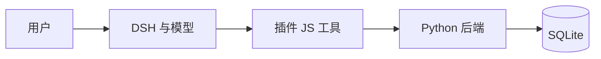

<div class="guide-kicker">SLIDEV / 可复制骨架</div>

# 从一页文字开始

先讲清内容，再加布局、颜色和交互。

<div class="guide-actions">
  <button @click.stop="$slidev.nav.next()" class="demo-button">
    开始练习 <carbon:arrow-right class="inline-block" />
  </button>
  <Link to="architecture">直接看架构图</Link>
</div>

<!--
这是一份语法练习骨架，不是完整汇报。点击开始练习，或跳到架构页。
-->

---
layout: two-cols
---

<div class="guide-kicker">01 / 双栏 ＋ 逐步展示</div>

# DSH 负责什么

- 对话入口
- 模型调用
- 工具调度

::right::

<div class="guide-kicker">按“下一步”，逐条显示</div>

# 插件负责什么

<v-clicks>

- 网页快照
- 引用校验
- 候选看板

</v-clicks>

<div class="guide-actions">
  <button @click.stop="$slidev.nav.next()" class="demo-button">下一步 →</button>
  <button @click.stop="$slidev.nav.nextSlide()" class="demo-button secondary">直接下一页</button>
</div>

<!--
“下一步”先显示右栏要点；“直接下一页”跳过本页剩余动画。
-->

---
layout: default
routeAlias: architecture
---

<div class="guide-kicker">02 / 文字生成架构图</div>

# 用节点与箭头解释调用方向

<p class="guide-lead">教学简图：展示 DSH 插件链路，未画出独立 CLI。</p>



<div class="guide-actions">
  <button @click.stop="$slidev.nav.nextSlide()" class="demo-button">看图片方式 →</button>
</div>

<!--
修改 Mermaid 文本，图会重新渲染。简图只说明主要调用方向，不代表所有实现细节。
-->

---
layout: default
---

<div class="guide-kicker">03 / 图片与矢量图</div>

# 也可以直接放已有架构图片


<p class="guide-lead">把自己的图放进 guide/public/，再修改这里的 src。</p>

<div class="guide-actions">
  <button @click.stop="$slidev.nav.nextSlide()" class="demo-button">看代码方式 →</button>
</div>

<!--
这一页使用独立 SVG 素材，上一页使用 Mermaid 源码。两种方式任选其一即可。
-->

---
layout: default
---

<div class="guide-kicker">04 / 代码高亮 ＋ 点击步骤</div>

# 引用存在，推论仍需核对

```python {all|2|3} {lines:true}
def inspect(quote, text):
    found = quote in text
    return found
```

<p v-click class="guide-lead">教学代码只判断文字是否出现，没有判断推荐结论是否成立。</p>

<div class="guide-actions">
  <button @click.stop="$slidev.nav.next()" class="demo-button">下一步 →</button>
  <button @click.stop="$slidev.nav.nextSlide()" class="demo-button secondary">直接下一页</button>
</div>

<!--
先看所有代码，再看第 2 行和第 3 行，最后显示边界说明。此代码不是项目源码原样复制。
-->

---
layout: default
---

<div class="guide-kicker">05 / 实操入口与回跳</div>

# 从解释切换到实际展示

<div class="guide-link-row">
  <carbon:logo-github class="inline-block text-2xl" />
  <a href="https://github.com/yuhaixin0924/agent" target="_blank" rel="noopener noreferrer">项目仓库 ↗</a>
</div>

<div class="guide-link-row">
  <carbon:document class="inline-block text-2xl" />
  <a href="http://localhost:3030/candidates.html" target="_blank" rel="noopener noreferrer">本机候选看板 ↗</a>
</div>

<p class="guide-lead">看板链接需另行运行原样稿（npm run dev）。DSH 实操请切换到应用窗口。</p>

<div class="guide-actions">
  <Link to="1">回到封面</Link>
  <Link to="architecture">回到架构图</Link>
</div>

<div class="guide-page-no"><SlideCurrentNo /> / <SlidesTotal /></div>

<!--
替换为自己实际可访问的演示入口。没有运行服务时，不要把链接当作已接通的功能。
-->
